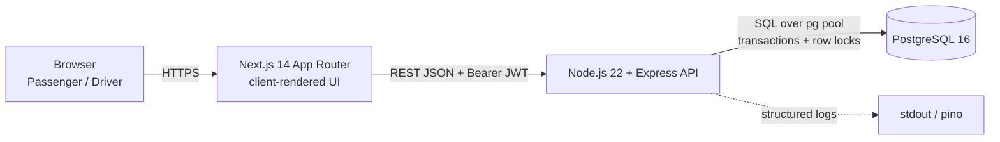
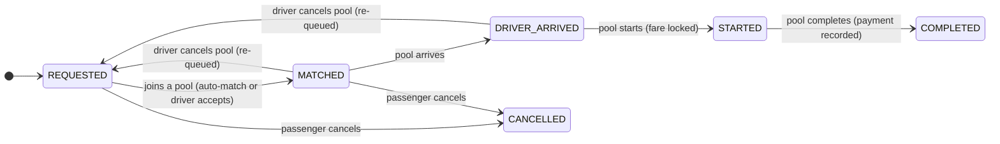

# Dhaka Tesla Pool - Architecture (written before the code)

This document is the design contract. If the implementation drifts, this file is updated in the same PR.

## 1. System context



Only four boxes. No Redis, queue, or microservice: the pooling invariant (seats never exceed capacity)
is a transactional problem and Postgres already solves it.

## 2. Actors and lifecycle

Actors: **Passenger** (Nusrat, Rafiq, Shirin), **Driver/Tesla** (Jashim, Bullet), **Ride/Pool**.

Two state machines, because a *request* belongs to one passenger while a *pool* belongs to one Tesla trip.



Pool: `ACCEPTED -> DRIVER_ARRIVED -> STARTED -> COMPLETED`, plus `CANCELLED` (driver, before start).

Improvements over the suggested lifecycle (and why):

| Change | Reason |
|---|---|
| Separate request and pool state machines | One pool moves N passengers together; a single status column cannot express "Nusrat cancelled but Rafiq is still riding". |
| `MATCHED` -> `REQUESTED` when a driver cancels | The passenger did nothing wrong; re-queue instead of cancelling their ride. |
| Passenger cancel only in `REQUESTED`/`MATCHED` | Once the Tesla has arrived, cancelling wastes the driver's trip. No cancellation-fee logic in MVP. |
| Fare locked at `STARTED` | Fare may fall (discount) while the pool is forming, but must not change mid-ride. |
| One active request per passenger, one active pool per Tesla | Enforced by partial unique indexes, not application code. |

## 3. Matching rule (documented assumption)

A waiting request R is compatible with pool P iff **all** of:

1. `R.pickup_zone == P.pickup_zone` (same pickup zone);
2. for every active member M of P: `distance(R.destination, M.destination) <= 4.0 km`
   (the destinations are on the same corridor; checking every member prevents drift);
3. `P.seats_taken + R.seats <= P.capacity`;
4. `P.status` in `ACCEPTED`, `DRIVER_ARRIVED` (no mid-trip joins).

Nusrat (Banani -> Mohakhali) and Rafiq (Banani -> Gulshan 1): same pickup, Mohakhali-Gulshan 1 = 3.5 km <= 4.0 km -> compatible.

Matching happens (a) automatically when a request is created and an open compatible pool exists, and
(b) when a driver accepts a waiting request.

## 4. Fare model

All money is **integer paisa** (1 BDT = 100 paisa): no floating-point drift, sums are exact, `bigint` in Postgres.

```
gross        = (BASE_FARE + round(distance_km * PER_KM)) * seats
poolDiscount = pooled ? floor(gross * 20 / 100) : 0      (pooled = 2+ passengers in the pool)
passengerFare = gross - poolDiscount
```

`BASE_FARE = 4000` (40 BDT), `PER_KM = 1500` (15 BDT/km), `POOL_DISCOUNT_PCT = 20`.
Distance comes from a fixed zone-to-zone table (no routing), see `backend/src/domain/zones.js`.

Hand check: Nusrat 4000 + 2.0*1500 = 7000 -> pooled 5600. Rafiq 4000 + 3.0*1500 = 8500 -> pooled 6800.

## 5. Concurrency design

Problem: Bullet has 1 seat left, Nusrat and Shirin both claim it at the same instant.

Three layers, each sufficient on its own to stop overbooking:

1. **Pool row lock.** Every join, leave and lifecycle transition starts with `SELECT ... FROM pools WHERE id = $1 FOR UPDATE`.
   Nusrat's and Shirin's transactions therefore queue on the same pool row; the second one only runs after the
   first has committed, re-reads `seats_taken`, and is rejected by the compatibility check (409).
2. **Conditional UPDATE.** The seat claim is
   `UPDATE pools SET seats_taken = seats_taken + $n WHERE id = $1 AND status IN (...) AND seats_taken + $n <= capacity RETURNING ...`
   and matching zero rows means "no seats". Redundant while the lock is held, kept so the claim stays correct
   if someone later removes or narrows the lock.
3. **`CHECK (seats_taken <= capacity)`** on `pools`: even a buggy code path cannot commit an overbooked pool.

Request claim: `UPDATE ride_requests SET status='MATCHED' WHERE id=$1 AND status='REQUESTED'` so two drivers
(or an accept racing a passenger cancel) cannot both win the same request.

Lock order is always **pool row -> request rows (ordered by id)**, never the reverse, so a join and a cancel
cannot form a deadlock cycle. Everything runs in one transaction; a failed claim rolls back as a unit.

At larger scale: see the "If Oi Tesla Goes Viral" section of the README.

## 6. ERD

```mermaid
erDiagram
  USERS ||--o| TESLAS : owns
  USERS ||--o{ RIDE_REQUESTS : makes
  ZONES ||--o{ RIDE_REQUESTS : pickup_or_destination
  TESLAS ||--o{ POOLS : runs
  ZONES ||--o{ POOLS : pickup
  POOLS ||--o{ POOL_MEMBERS : has
  RIDE_REQUESTS ||--o{ POOL_MEMBERS : joins
  RIDE_REQUESTS ||--o| PAYMENTS : settled_by
  USERS ||--o{ RIDE_EVENTS : acts

  USERS { uuid id PK
    text name
    text email UK
    text password_hash
    text role
    bigint wallet_balance_paisa }
  TESLAS { uuid id PK
    uuid driver_id FK_UK
    text name
    text plate UK
    int capacity
    bool is_online }
  ZONES { text id PK
    text name
    numeric lat
    numeric lng }
  RIDE_REQUESTS { uuid id PK
    uuid passenger_id FK
    text pickup_zone FK
    text destination_zone FK
    int seats
    text status
    text payment_method
    bigint fare_paisa
    jsonb fare_breakdown
    bool fare_locked }
  POOLS { uuid id PK
    uuid tesla_id FK
    text pickup_zone FK
    text status
    int capacity
    int seats_taken }
  POOL_MEMBERS { uuid id PK
    uuid pool_id FK
    uuid request_id FK
    int seats
    timestamptz joined_at
    timestamptz left_at
    text left_reason }
  PAYMENTS { uuid id PK
    uuid request_id FK_UK
    uuid passenger_id FK
    uuid driver_id FK
    text method
    bigint amount_paisa }
  RIDE_EVENTS { bigint id PK
    text entity_type
    uuid entity_id
    text from_status
    text to_status
    uuid actor_user_id FK
    jsonb metadata }
```

Table notes live next to the DDL in `backend/src/db/migrations/001_init.sql`.
